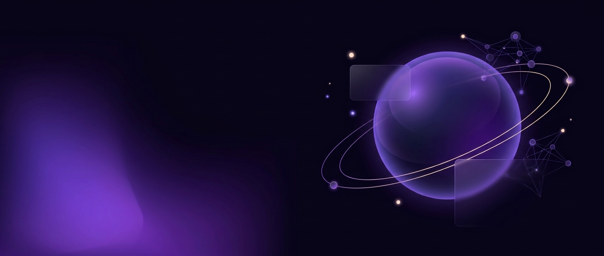

<div align="center">
  

  <h1>Mobashra Saeed</h1>
  <p>
    <b>Applied NLP &amp; Machine Learning &nbsp;|&nbsp; Full-Stack AI Systems Engineer</b><br/>
    <sub>B.S. Information Technology (3.77 CGPA) • The Islamia University of Bahawalpur • TOEFL iBT: 110/120 (CEFR C1)</sub>
  </p>

  <p>
    <a href="https://mobashra-portfolio.vercel.app/">
      
    </a>
    <a href="https://www.linkedin.com/in/msaeed83/">
      
    </a>
    <a href="mailto:mobashrasaeed713@gmail.com">
      
    </a>
  </p>
</div>

---

### 🔮 Research Focus & Engineering Philosophy
I bridge **Natural Language Processing (NLP)** research with **scalable full-stack web engineering**. My undergraduate thesis focused on automated misinformation detection and eliminating data leakage in high-dimensional text classification pipelines. I am actively seeking **Graduate Research Assistantship (GRA)** opportunities for Fall in **Applied NLP, Text Mining, and Human-Centered AI**.

```mermaid
%%{init: {'theme': 'dark', 'themeVariables': { 'primaryColor': '#16102B', 'primaryTextColor': '#F3E8FF', 'primaryBorderColor': '#9333EA', 'lineColor': '#A855F7', 'secondaryColor': '#090712', 'tertiaryColor': '#1E1B4B'}}}%%
flowchart LR
    A["📄 Unstructured Corpora<br/>(44k+ News Articles)"] --> B["⚙️ NLP Preprocessing<br/>(Regex, NLTK, TF-IDF)"]
    B --> C["🧠 ML & Statistical Modeling<br/>(Gradient Boosting, Hybrid Scoring)"]
    C --> D["⚡ REST API Inference<br/>(Flask / Node.js / Gemini)"]
    D --> E["🖥️ Interactive UI Systems<br/>(Next.js / Angular / React)"]
